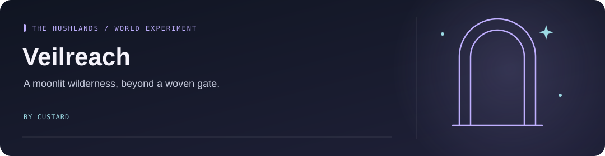

<!-- Project artwork created for this repository. -->
<p align="center">
  
</p>

<h1 align="center">Veilreach</h1>

<p align="center">
  
</p>

**A Minecraft adventure-dimension prototype set in a moonlit wilderness of silver fog and ruined star-altars.**

<p align="center"><a href="#the-idea">The idea</a> &nbsp; · &nbsp; <a href="#build-and-run">Build and run</a> &nbsp; · &nbsp; <a href="#find-the-pieces">Find the pieces</a></p>

## The idea

Enter the Hushlands through a Moonwoven gate, explore its ruins, and work toward deeper regions. The visual theme combines cold light, mirrorstone, crystal roots, and quiet, overgrown observatories.

The repository contains dimension and portal code, custom blocks and items, creatures, progression systems, and vehicle/combat experiments. The complete adventure loop is still a prototype; source modules are not a claim of finished gameplay.

## Build and run

Use **JDK 21**. Minecraft and Fabric versions are pinned in `gradle.properties`; the Gradle wrapper is included.

```powershell
.\gradlew.bat runClient
.\gradlew.bat build
```

On macOS/Linux, use `./gradlew` instead. Build output goes to `build/libs/`. These are development builds; use a separate test world.

## Find the pieces

- `src/main/java/com/muguett/veilreach/` — gameplay, entities, rendering, and progression.
- `src/main/resources/` — assets and data definitions.
- `tools/` — texture, interface, and audio-generation utilities.

Licensed under [MIT](LICENSE).
